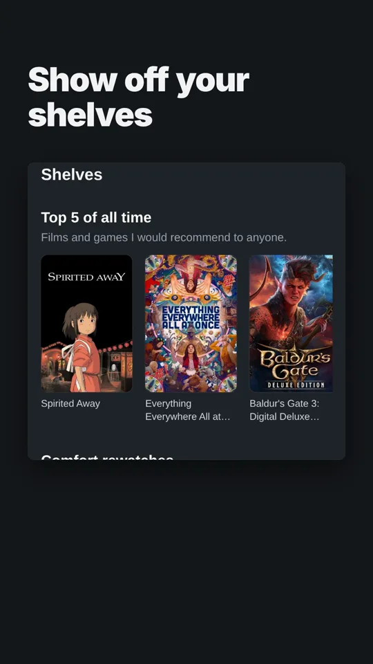
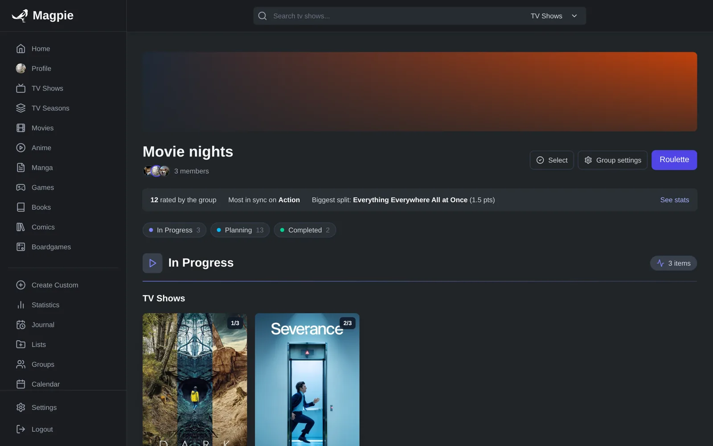
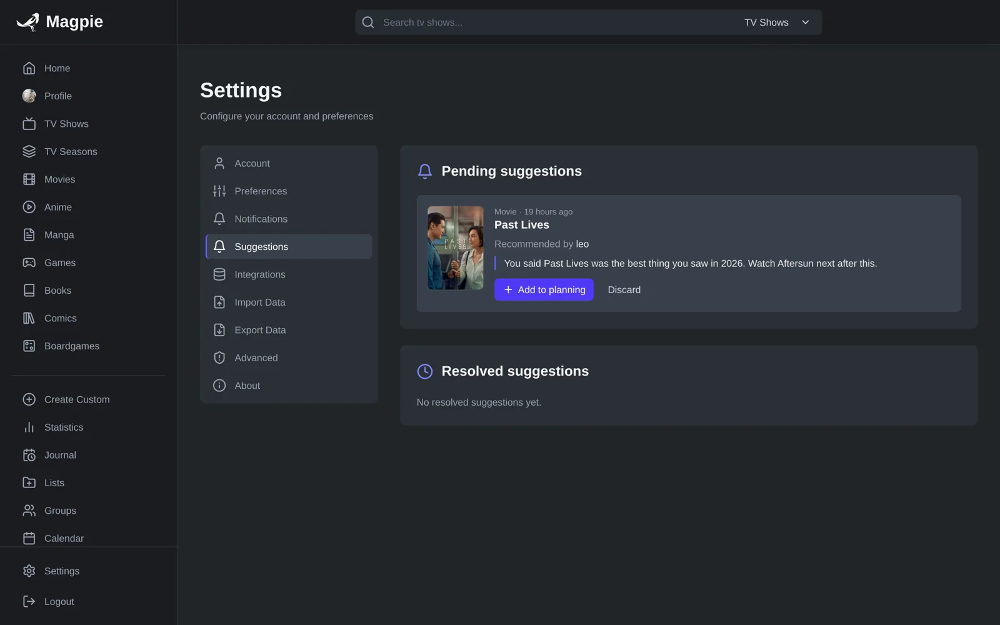
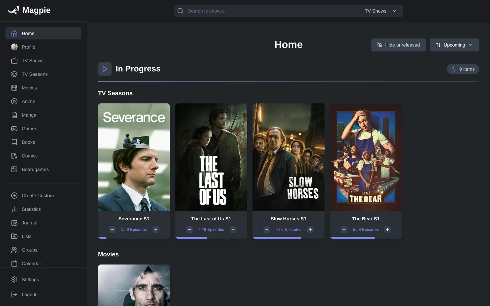
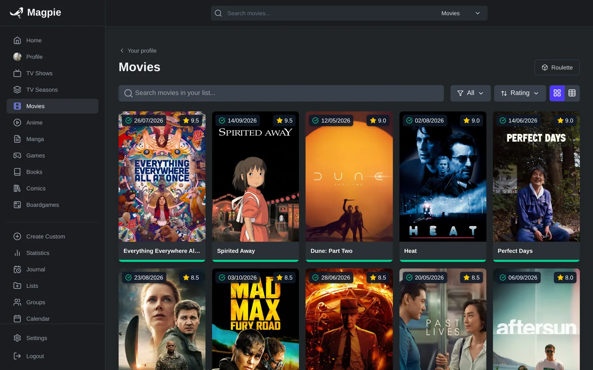
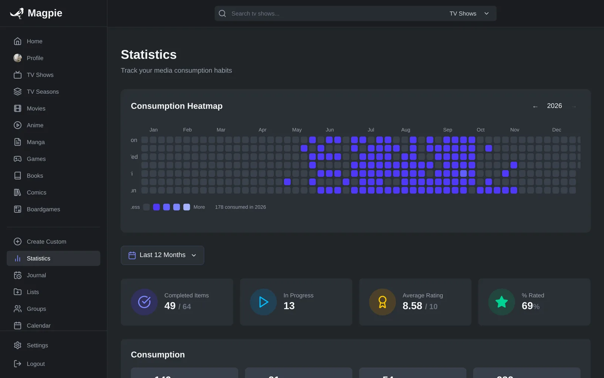

<!-- --8<-- [start:docs-index-intro] -->

<p align="center">
  <picture>
    <source media="(prefers-color-scheme: dark)" srcset="https://raw.githubusercontent.com/YellowUmbrellaDev/Magpie/dev/src/static/favicon/logo.svg">
    
  </picture>
</p>

# Magpie


Magpie is a self-hosted media tracker for movies, TV shows, anime, manga, video games, books, comics and board games. You can track on your own or with friends, share a public profile, and let it pick what to watch next.

Magpie is a fork of [Yamtrack](https://github.com/FuzzyGrim/Yamtrack) by [FuzzyGrim](https://github.com/FuzzyGrim). Everything Yamtrack does well (providers, imports, calendar, notifications, media server integrations) comes from there. Magpie builds social tracking, discovery and an API on top of it and now follows its own roadmap. It won't be merged back upstream.

<p align="center">
  <a href="https://github.com/YellowUmbrellaDev/Magpie/blob/dev/docs/assets/magpie-9x16.mp4">
    
  </a>
  <br>
  <sub>▶️ <a href="https://github.com/YellowUmbrellaDev/Magpie/blob/dev/docs/assets/magpie-9x16.mp4">Watch the 40-second tour</a></sub>
</p>

<!-- --8<-- [end:docs-index-intro] -->

## 📚 Documentation

The documentation lives in [`docs/`](docs/) and is published at [yellowumbrelladev.github.io/Magpie](https://yellowumbrelladev.github.io/Magpie/).

<!-- --8<-- [start:docs-index-body] -->

## 📸 Screenshots

| Public profile | Groups |
| --- | --- |
|  |  |
| **Suggestions from friends** | **Home** |
|  |  |
| **Your lists** | **Statistics** |
|  |  |

## ✨ Features

### Track everything

- 🎬 Movies, TV shows, anime, manga, games, books, comics and board games, all in one library.
- 📺 Track each TV season on its own, down to individual episodes.
- ⭐ Save score, status, progress, repeats, start and end dates, and a comment.
- 📈 Keep a full history of every change to every entry.
- ✏️ Add custom entries for media the providers don't know about.
- 📂 Create lists and invite others to collaborate on them.
- 📅 Upcoming releases on a calendar, also available as an iCalendar (.ics) feed.
- 🔔 Release notifications through Apprise (Discord, Telegram, ntfy, Slack, email and more).

### Together

- 👥 **Groups.** Track a show, a game or a book with your partner or friends. The group has its own progress, and logging a session also updates each participant's personal record. It never rolls anyone back or reopens something they've already finished.
- ➕ **Add to a group from any poster**, Spotify-style, and pick who took part each time you log progress.
- 📊 **Group stats** compare scores and genres between members.

### Public profile

- 🪪 **A profile at `/<username>`** with avatar, activity heatmap, a diary of what you've been watching and reading, and your reviews.
- 🗂️ **Shelves.** Hand-picked showcases like your top 5, mixing any media types.
- 🔒 **Per-section visibility.** Profiles are open by default, and you can hide the heatmap, shelves or reviews one by one.
- 💌 **Recommend to a friend** from their profile, and get suggestions in your own inbox.

### Discovery

- 🎲 **Roulette** for when you can't choose. It only draws from your planned list, filtered by type, genre, movie length or game mode (single-player, co-op, competitive). It works for you or for a whole group.
- 🧭 **Recommendations** based on your scores, genres and history. Group recommendations weigh every member equally.
- 🙅 **Not interested.** Hide a title from the roulette and recommendations, with undo and a Discarded tab to bring it back.

### Integrations

- 🦀 [Jellyfin](https://jellyfin.org/), [Plex](https://plex.tv/) and [Emby](https://emby.media/) webhooks track what you watch automatically, plus a generic scrobble webhook for anything else.
- 📥 Import from [Trakt](https://trakt.tv/), [Simkl](https://simkl.com/), [MyAnimeList](https://myanimelist.net/), [AniList](https://anilist.co/), [Kitsu](https://kitsu.app/), [Letterboxd](https://letterboxd.com/), [GoodReads](https://www.goodreads.com/), [Steam](https://store.steampowered.com/), [IMDb](https://www.imdb.com/) and [HowLongToBeat](https://howlongtobeat.com/), with periodic automatic imports where the source allows it.
- 📊 Export everything to CSV and import it back. Yamtrack CSV backups import as-is. You can also export to Letterboxd.
- 🔌 **REST API** (`/api/v1/`) with an OpenAPI schema ([`src/api/openapi.yaml`](src/api/openapi.yaml), served at `/api/schema/`) and named personal tokens with separate read and write scopes that you can revoke at any time.

### Self-hosted

- 🐳 Docker Compose with SQLite or PostgreSQL.
- 📱 Installable as an app (PWA) on phone and desktop, with an offline page.
- 🔑 Multiple users, plus OIDC and 100+ social login providers through django-allauth.

## 🐳 Installing with Docker

Download the `docker-compose.yml` file from the repository, update the environment values, and start Magpie:

```bash
curl -LO https://raw.githubusercontent.com/YellowUmbrellaDev/Magpie/dev/docker-compose.yml
docker compose up -d
```

The default Compose file uses SQLite, which is enough for most personal installs. For PostgreSQL and reverse proxy setups, see the [setup docs](docs/setup.md). All settings are listed in [environment variables](docs/env-variables.md).

### Coming from Yamtrack

Export your data from Yamtrack (**Settings → Export → CSV**) and import that file in Magpie (**Settings → Import → Magpie CSV**).

## 💻 Development

See the [development docs](docs/development.md).

## 💪 Support

### 🐛 Bugs and ideas

Open an [issue](https://github.com/YellowUmbrellaDev/Magpie/issues). Steps to reproduce make bugs much faster to fix.

### 🧪 Contributing

Pull requests are welcome, from typos to new features.

### ☕ Donate

Most of the work that makes Magpie possible was done by FuzzyGrim on Yamtrack. If you'd like to support it financially, donate to them:

[](https://ko-fi.com/fuzzygrim)

<!-- --8<-- [end:docs-index-body] -->

## 📜 License and credits

Magpie is licensed under the [AGPL-3.0](LICENSE), like Yamtrack.

- Based on [Yamtrack](https://github.com/FuzzyGrim/Yamtrack) by FuzzyGrim and its contributors.
